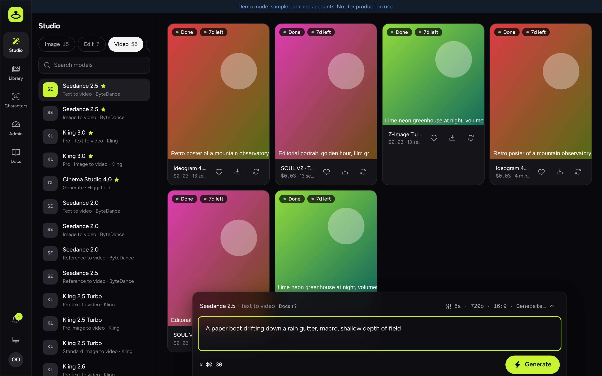
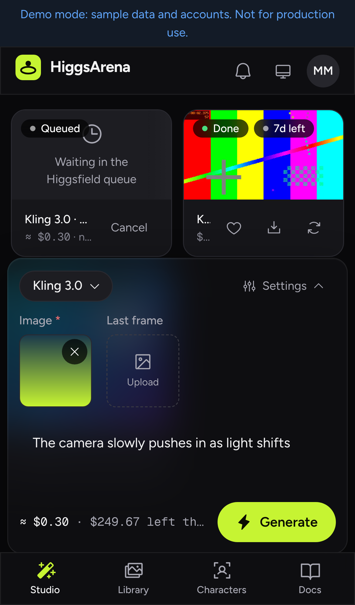

# HiggsArena

**One self-hosted studio for every Higgsfield API model, with team budgets, model controls and cost analytics.**

Clone it, add a Higgsfield API key, and your team gets a polished studio for image, edit, video, motion and character workflows. Admins decide which models are available, who can use them and how much each person or team may spend.

> HiggsArena is an independent open-source project that works with the Higgsfield API. It is not affiliated with or endorsed by Higgsfield. MIT licensed.

| Studio (desktop) | Studio (phone) |
| --- | --- |
|  |  |

## Features

- **All 84 Higgsfield workflows** (17 image, 67 video) from a model catalog generated from the Higgsfield docs. A new model is a catalog update, not a code change.
- **Studio**: tool switcher (Image, Edit, Video, Motion, Characters), forms built from each model's schema, drag-and-drop or camera-roll uploads, live cost estimate, live job feed, cancel while queued, remix any result.
- **Library**: masonry grid with filters, full-screen viewer, favourites, expiry badges, delete (also deletes on Higgsfield), org-wide view for admins.
- **Characters**: train Soul ID characters from 1–100 photos and use them in SOUL models.
- **Admin console**: models on/off, invitations, roles, teams, restrictions at org / team / member level (strictest wins), monthly budgets with a hard stop and one-click override approval, encrypted API keys, output retention and S3/R2 mirroring, audit log with CSV export.
- **Analytics**: spend by day and month (image vs video), by model, member and team against budgets, status mix, median time per model, month-end projection, override activity, CSV export.
- **Email**: Resend and Brevo with automatic fallback, for invitations, verification, password reset, budget alerts, override decisions and key problems.
- **Secure by default**: keys never reach the browser, AES-256-GCM encryption at rest, no first-user-becomes-admin, invite-only sign-up, nonce CSP, signed webhooks, SSRF-safe mirroring, refuses to start in production with demo secrets.
- **Feels native** on desktop and phone: dark and light themes, frosted glass, 44px tap targets, safe-area aware, reduced-motion support.

## Contents

- [Local install (10 minutes)](#local-install)
- [Getting a Higgsfield key](#getting-a-higgsfield-key)
- [Deploy to a VPS with Docker](#deploy-to-a-vps-with-docker)
- [Email: Resend or Brevo](#email-resend-or-brevo)
- [Google and GitHub sign-in](#google-and-github-sign-in)
- [Storage: S3 or R2](#storage-s3-or-r2)
- [Security checklist](#security-checklist)
- [Key rotation](#key-rotation)
- [Backups and restores](#backups-and-restores)
- [Upgrading](#upgrading)
- [Adding or fixing a model](#adding-or-fixing-a-model)
- [Environment variables](#environment-variables)
- [Troubleshooting](#troubleshooting)
- [Contributing](#contributing)

## Local install

**You need:** Node.js 20.9+ (22 recommended), [pnpm](https://pnpm.io/installation) (npm also works), and Docker (or any PostgreSQL 16).

```bash
git clone https://github.com/hossanatito/higgsarena.git
cd higgsarena
pnpm install
pnpm run setup          # copies .env.example to .env with fresh random secrets
```

Open `.env` and set `OWNER_EMAILS` to the email you'll sign up with. Then:

```bash
pnpm db:up              # starts Postgres in Docker on 127.0.0.1:5432
pnpm db:migrate         # creates the tables
pnpm db:seed            # loads the model catalog (and demo users when DEMO_MODE=true)
pnpm dev
```

Open <http://localhost:3000>, choose **Create an account** with your owner email, and you land in the admin setup checklist. Add your Higgsfield key in **Admin → API keys** (or put `HF_API_KEY_ID` / `HF_API_KEY_SECRET` in `.env` before seeding).

> `pnpm setup` (without `run`) is a built-in pnpm command, so use `pnpm run setup`. With npm: `npm run setup`.

**Just want to look around?** Set `DEMO_MODE=true` and `OWNER_EMAILS=owner@demo.local` in `.env`, run `pnpm db:seed`, and sign in as `owner@demo.local`, `admin@demo.local` or `member@demo.local` with password `arena-demo-password`. To try generations without a key, run the [local Higgsfield mock](CONTRIBUTING.md#work-without-a-higgsfield-key). Demo mode shows a banner and is blocked in production.

In development, emails (verification, invitations, password resets) are printed to the terminal running `pnpm dev` until you configure a provider.

## Getting a Higgsfield key

1. Sign in to the [Higgsfield Console](https://console.higgsfield.ai) and create an API key. You get a **key ID** and a **key secret**.
2. In HiggsArena, open **Admin → API keys**, paste both (or `id:secret` in the first field) and save. HiggsArena tests the key with a free cost estimate.
3. For instant results, open **Settings** in the Higgsfield Console, reveal the **webhook signing secret** (it starts with `whsec_`) and paste it in **Admin → API keys → Webhooks**. Webhooks need a public `https://` `APP_URL`; without them HiggsArena polls, which also works.

New to the API? The [Higgsfield quickstart](https://docs.higgsfield.ai/docs/quickstart.md) walks through a first request.

## Deploy to a VPS with Docker

This is the primary production path. It gives you HiggsArena, PostgreSQL, automatic HTTPS (Caddy + Let's Encrypt), the background sweep, and nightly backups.

### 1. Server

Ubuntu 24.04 LTS with at least **2 vCPU and 4 GB RAM**, and a domain (e.g. `studio.example.com`) with an **A record pointing at the server's IP**.

### 2. Harden it

```bash
# as root
adduser deploy && usermod -aG sudo deploy
mkdir -p /home/deploy/.ssh && cp ~/.ssh/authorized_keys /home/deploy/.ssh/ && chown -R deploy:deploy /home/deploy/.ssh
# SSH keys only
sed -i 's/^#\?PasswordAuthentication .*/PasswordAuthentication no/; s/^#\?PermitRootLogin .*/PermitRootLogin no/' /etc/ssh/sshd_config
systemctl restart ssh
# Firewall: SSH, HTTP, HTTPS
ufw allow 22/tcp && ufw allow 80/tcp && ufw allow 443/tcp && ufw --force enable
```

Log back in as `deploy` for the remaining steps.

### 3. Install Docker Engine and the Compose plugin

```bash
curl -fsSL https://get.docker.com | sudo sh
sudo usermod -aG docker $USER && newgrp docker
docker compose version
```

### 4. Clone and configure

```bash
git clone https://github.com/hossanatito/higgsarena.git
cd higgsarena
./scripts/setup.sh            # no Node needed; or: pnpm run setup --production
```

It asks for your domain, the owner email(s) and the Let's Encrypt email, then writes `.env` with fresh secrets (`BETTER_AUTH_SECRET`, `ENCRYPTION_KEY`, `CRON_SECRET`, a Postgres password), `APP_URL=https://your-domain` and `TRUST_PROXY=true`. Optionally add `HF_API_KEY_ID`, `HF_API_KEY_SECRET`, `HF_WEBHOOK_SECRET` and email keys to `.env` now; you can also do it in the admin console later.

### 5. Start

```bash
docker compose --profile production up -d --build
```

This starts:

| Service | What it does |
| --- | --- |
| `app` | The HiggsArena image. Checks the config, runs migrations and syncs the catalog on boot. Refuses to start with demo secrets or a non-https `APP_URL`. |
| `db` | PostgreSQL 16 with a named volume, bound to `127.0.0.1` only. |
| `caddy` | Reverse proxy with automatic HTTPS from Let's Encrypt. The only service on ports 80/443. |
| `cron` | Calls `/api/cron/sweep` every minute with `CRON_SECRET`: finishes stuck jobs, mirrors outputs, expires override requests. |
| `backup` | Nightly `pg_dump` into `./backups` with 14-day rotation. |

Watch the first start with `docker compose logs -f app`. When you see the server listening, open `https://your-domain`.

### 6. First sign-in

Sign up with an email from `OWNER_EMAILS` and verify it (configure email first, or read the link from `docker compose logs app` if no provider is set yet). Owners land on the setup checklist: Higgsfield key, webhook secret, email provider, invite your team.

### 7. Webhooks

Copy the webhook signing secret (`whsec_…`) from **Higgsfield Console → Settings** into **Admin → API keys**. HiggsArena then receives signed results at `https://your-domain/api/webhooks/higgsfield`.

### 8. Backups

Backups land in `./backups` every night and are kept 14 days (`BACKUP_RETENTION_DAYS`). Copy them off the server too, for example to S3 / R2 with a host cron job:

```bash
# crontab -e
30 4 * * * aws s3 sync /home/deploy/higgsarena/backups s3://your-bucket/higgsarena-backups --delete
```

See [Backups and restores](#backups-and-restores) to restore.

### 9. Updates

```bash
git pull && docker compose --profile production up -d --build
```

Migrations run automatically when the new container starts.

### 10. Monitoring

- `https://your-domain/api/health` returns `{"status":"ok"}` when the app and database are up. Point an uptime checker at it.
- `docker compose logs -f app` for application logs; Higgsfield errors include the request ID and `X-Correlation-ID` for support.
- **Admin → Settings → Health** shows database, email, storage and Higgsfield key status.

Guides for Vercel and Railway / Render are planned for a later release.

## Email: Resend or Brevo

Configure in **Admin → Settings → Email** (keys are encrypted), or as a fallback in `.env` (`RESEND_API_KEY`, `BREVO_API_KEY`, `EMAIL_FROM`). Pick a primary and optionally the other as fallback: if a send fails, HiggsArena retries once on the fallback and logs both attempts.

- **Resend**: add and verify your domain at [resend.com/domains](https://resend.com/domains) (SPF and DKIM DNS records), create an API key, and use a from address on that domain.
- **Brevo**: verify your domain under *Senders, Domains & Dedicated IPs*, create an API key (SMTP & API → API keys), and use a verified sender address.

Use **Send test email** to check it. Emails use one shared layout with a plain-text version and no tracking pixels.

## Google and GitHub sign-in

Each provider is enabled when its two variables are set in `.env`; restart the app after changing them. Accounts with the same verified email link together.

- **Google**: in [Google Cloud Console](https://console.cloud.google.com/apis/credentials) create an *OAuth client ID* (Web application). Authorized redirect URI: `https://your-domain/api/auth/callback/google`. Set `GOOGLE_CLIENT_ID` and `GOOGLE_CLIENT_SECRET`.
- **GitHub**: in [GitHub → Settings → Developer settings → OAuth Apps](https://github.com/settings/developers) create an app. Authorization callback URL: `https://your-domain/api/auth/callback/github`. Set `GITHUB_CLIENT_ID` and `GITHUB_CLIENT_SECRET`.

**Admin → Settings → Sign-in methods** shows the exact callback URLs for your install. OAuth sign-ups follow the same sign-up policy as email (invite only by default).

## Storage: S3 or R2

Higgsfield deletes outputs 7 days after a job finishes. To keep them, add a bucket in **Admin → Settings → Storage**, press **Test connection**, then turn on **Admin → Output → Mirror outputs to storage**.

- **Cloudflare R2**: create a bucket and an API token with *Object Read & Write*. Endpoint `https://<account-id>.r2.cloudflarestorage.com`, region `auto`. For public files, connect a custom domain and set it as the public base URL; otherwise HiggsArena serves 1-hour signed URLs.
- **AWS S3**: leave the endpoint empty, set the region and bucket, and use an IAM user limited to `s3:PutObject`, `s3:GetObject`, `s3:DeleteObject` and `s3:ListBucket` on that bucket.
- **Backblaze B2 / MinIO**: use the S3 endpoint; for MinIO tick *Path-style URLs*.

Mirroring only fetches `https://` URLs and blocks private network addresses.

## Security checklist

Before going live, work through the checklist in [SECURITY.md](SECURITY.md#pre-deploy-checklist). The short version: fresh secrets in `.env`, an `https://` `APP_URL`, invite-only sign-up with email verification on, a working email provider, the webhook secret saved, the firewall allowing only 22/80/443, and a tested restore.

Report vulnerabilities privately; see [SECURITY.md](SECURITY.md).

## Key rotation

To rotate `ENCRYPTION_KEY` (the key that encrypts stored secrets):

```bash
# 1. In .env, move the current key to ENCRYPTION_KEY_PREVIOUS and set a new one:
openssl rand -base64 32
# 2. Restart, then re-encrypt everything with the new key:
docker compose --profile production up -d
docker compose exec app node dist/cli.mjs keys:rotate      # locally: pnpm keys:rotate
# 3. Remove ENCRYPTION_KEY_PREVIOUS from .env and restart again.
```

To rotate the Higgsfield key, create a new key in the Higgsfield Console and save it in **Admin → API keys** (the old one is replaced). Rotating `BETTER_AUTH_SECRET` signs everyone out.

## Backups and restores

```bash
# Run a backup now
docker compose --profile production run --rm backup sh /backup.sh
# Restore (replaces ALL data; asks for confirmation)
./scripts/restore.sh backups/higgsarena-2026-11-26T030000Z.sql.gz
```

Keep a copy of `.env` somewhere safe as well: without `ENCRYPTION_KEY`, stored secrets in a backup can't be decrypted (you would re-enter them).

## Upgrading

```bash
git pull
docker compose --profile production up -d --build
```

Read the release notes first. Migrations run automatically. Admins then press **Admin → Settings → Sync catalog** to pick up new models (it also runs on every boot and never overwrites your toggles or edits).

## Adding or fixing a model

Owners can fix one install from **Admin → Settings → Model catalog**: edit a model's fields as JSON, paste the *Complete JSON schema* from the model's Higgsfield docs page, or add a custom model by endpoint. Custom models start disabled.

To update the shipped catalog for everyone, run `pnpm catalog:pull` and open a pull request. Details in [CONTRIBUTING.md](CONTRIBUTING.md#adding-or-fixing-a-model).

## Environment variables

| Variable | Required | Purpose |
| --- | --- | --- |
| `DATABASE_URL` | Yes | Postgres connection string |
| `APP_URL` | Yes | Public URL; must be `https://` in production; used for links, OAuth callbacks and webhooks |
| `BETTER_AUTH_SECRET` | Yes | Session signing secret, 32+ random characters |
| `ENCRYPTION_KEY` | Yes | 32 random bytes, base64, encrypts stored secrets |
| `ENCRYPTION_KEY_PREVIOUS` | No | Previous key during rotation |
| `OWNER_EMAILS` | Yes | Comma-separated emails that become owners (verified email required in production) |
| `DEMO_MODE` | No | Seed demo users and show a banner; blocked in production |
| `HF_API_KEY_ID`, `HF_API_KEY_SECRET` | No | Bootstrap the organization key on first run |
| `HF_WEBHOOK_SECRET` | No | `whsec_` signing secret for the bootstrap key |
| `GOOGLE_CLIENT_ID`, `GOOGLE_CLIENT_SECRET` | No | Enables Google sign-in |
| `GITHUB_CLIENT_ID`, `GITHUB_CLIENT_SECRET` | No | Enables GitHub sign-in |
| `RESEND_API_KEY`, `BREVO_API_KEY`, `EMAIL_FROM` | No | Email fallback when not set in the console |
| `CRON_SECRET` | Production | Protects `/api/cron/sweep` |
| `ACME_EMAIL`, `DOMAIN` | Production (VPS) | Let's Encrypt email and the domain Caddy serves |
| `POSTGRES_PASSWORD` | Production (VPS) | Password for the bundled Postgres |
| `TRUST_PROXY` | No | `true` behind a proxy you control (set by the VPS setup) so client IPs come from `X-Forwarded-For` |

## Troubleshooting

**`ECONNREFUSED 127.0.0.1:5432` / database not running.** Start it with `pnpm db:up` (needs Docker running) or point `DATABASE_URL` at your own Postgres 16. Check with `docker compose ps`.

**"HiggsArena configuration problem" on start.** The message lists each problem. Usually a variable is missing or still a demo value: run `pnpm run setup` (or `./scripts/setup.sh`), which only replaces missing or demo values. In production `APP_URL` must start with `https://`.

**Port 3000 is in use.** Run `pnpm dev -p 3001` and set `APP_URL=http://localhost:3001`, or stop the other process (`lsof -i :3000`).

**"The Higgsfield API key is missing or invalid" (401).** Re-enter the key ID and secret in **Admin → API keys** and press **Test key**. Make sure the key wasn't disabled in the Higgsfield Console.

**"Insufficient balance" (403).** Top up the account in the Higgsfield Console. Admins also get an email and an in-app notice.

**Emails not arriving.** Check **Admin → Settings → Email → Send test email**; the result shows each provider's error. The from address must be on a domain you verified with the provider. Without a provider, development prints emails to the terminal and production logs an error.

**Sign-up says "invite only".** That's the default. Add your email to `OWNER_EMAILS`, or have an admin invite you, or change the policy in **Admin → Settings → Sign-up policy**.

**Jobs stay "Queued" forever.** Check that the `cron` service runs (`docker compose ps`) and that `CRON_SECRET` matches. Higgsfield queues jobs above your account's concurrency limit; they start automatically.

**Results expire.** Higgsfield deletes outputs after 7 days. Turn on [storage mirroring](#storage-s3-or-r2) to keep them.

**Let's Encrypt fails.** The domain's A record must point at the server and ports 80 and 443 must be open. See `docker compose logs caddy`.

## Contributing

Pull requests are welcome. See [CONTRIBUTING.md](CONTRIBUTING.md) for the development setup (including a mock Higgsfield API), the code map and how the catalog works.

## License

[MIT](LICENSE). HiggsArena is not affiliated with Higgsfield; "Higgsfield" is used only to describe the API this project works with.
